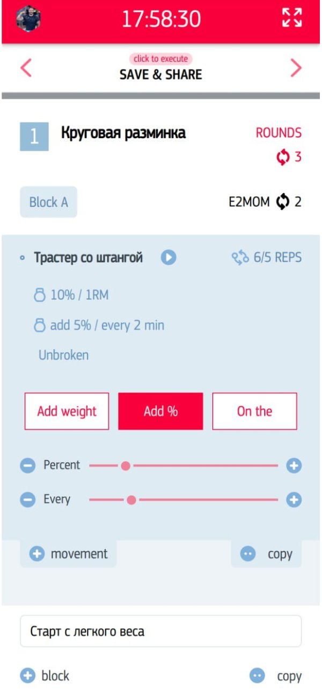
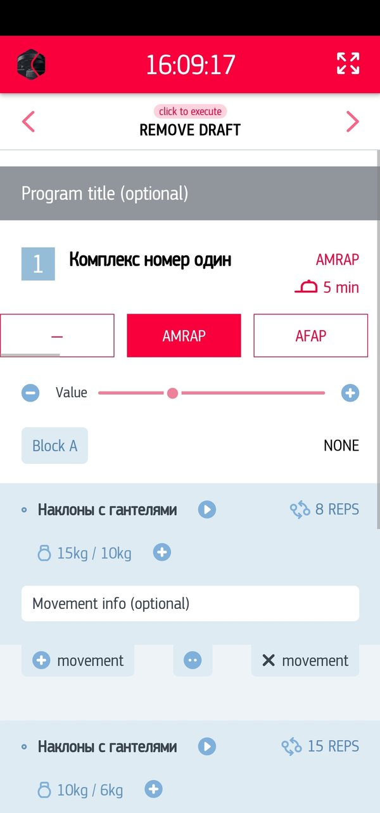
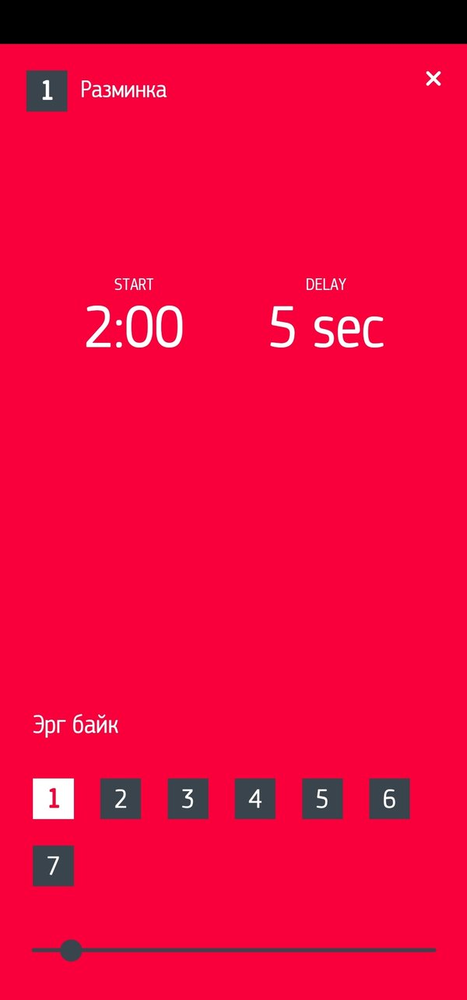
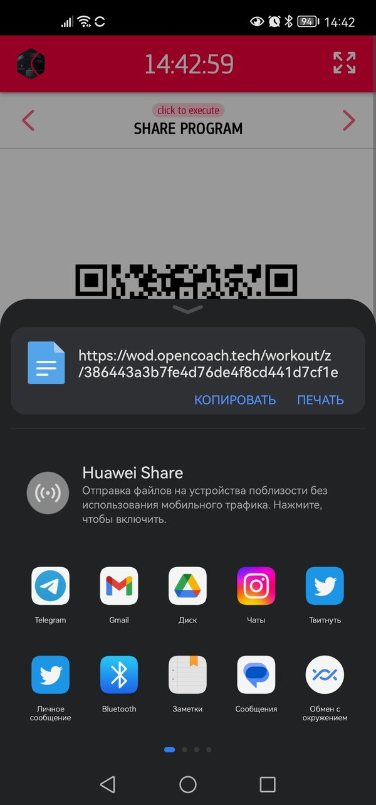
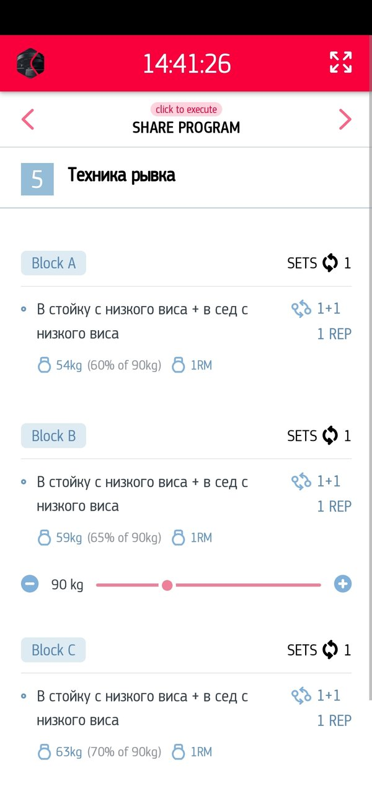
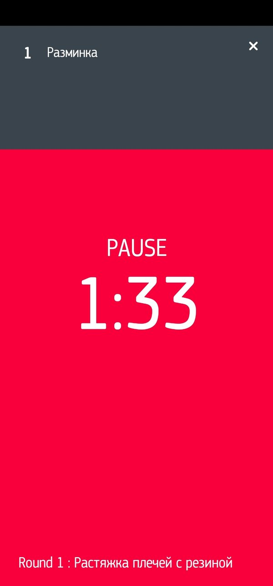
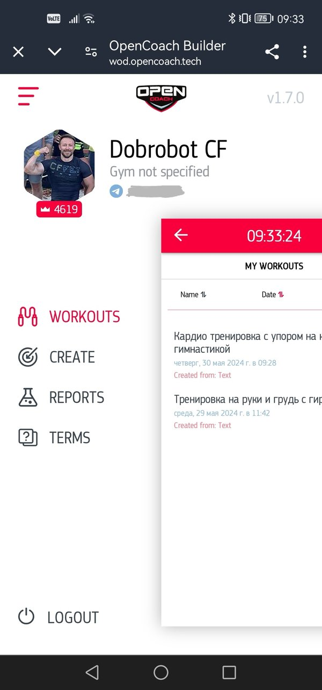
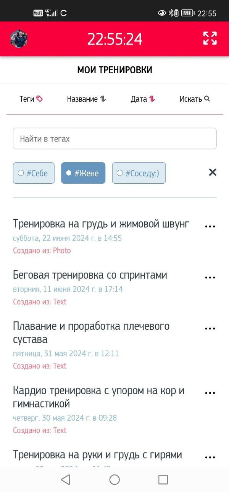
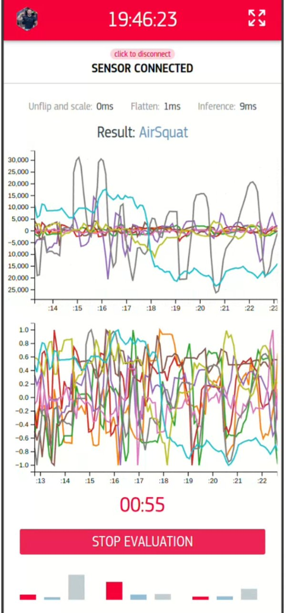
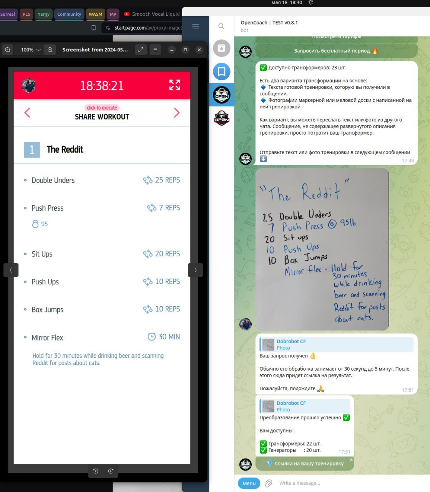

# OpenCoach Builder (wod-builder)

Mobile-first web app for coaches and athletes: build structured CrossFit / weightlifting / street workout / track-and-field programs, run them with a voice-guided interval timer, and share them via a link or a QR code.

Built at OpenCoach as the client of the OpenCoach platform (production URL: `wod.opencoach.tech`). Written in **TypeScript on Cycle.js + xstream**: the whole app is a single pure function from source streams to sink streams, and every side effect (DOM, HTTP, cookies, storage, camera, speech, audio, sharing) is isolated in a driver.

<p align="center">
  
  &nbsp;&nbsp;
  
  &nbsp;&nbsp;
  
  &nbsp;&nbsp;
  
</p>

## Features

- **Program builder.** A program is a tree: complex → block → movement config → movement. Each level has its own parameters: type, value, goal, load, video, info.
- **Rich domain model.** 4 sports, 18 complex types (AMRAP, AFAP, ROUNDS, SETS, LADDER, EMOM, E2MOM … E15MOM, TABATA and others), 11 goal types, 13 load types (absolute weight, % of 1RM / 5RM / 10RM, progression "add weight / add % / add reps every N min", pace, height, distance and more). Per-sport restrictions show only the options valid for the selected sport.
- **Custom slider controls** for fast value input on a phone, with discrete value scales for time, reps, calories, distance, length and weight.
- **Workout runner.** Interval timer with rounds, start delay and pauses; audio beeps through the Web Audio API.
- **Voice.** Speech recognition for screen commands ("share program", "remove draft", "edit program" and others). Speech synthesis announces the current and the next movement during a workout and speaks login and validation messages.
- **Sharing.** A program is serialized, compressed with LZ-String and turned into a short link through the backend shortener. The app generates a QR code for the link and can scan QR codes with the phone camera. On mobile it uses the Web Share API.
- **Coach tools.** Group programs into products, invite athletes by e-mail, grant and revoke access.
- **Offline-friendly drafts.** The current draft is kept in localStorage; the session is restored from cookies or localStorage with auto-login.
- **Bilingual UI.** English and Russian, chosen from `navigator.language`.
- **PWA-style shell.** Fullscreen mode, home-screen icons, theme color.

## Screenshots

### In this repository

| Workout builder | Program builder (AMRAP) | Load as % of 1RM |
|---|---|---|
|  |  |  |

| Timer: start | Timer: pause | Share by link and QR code |
|---|---|---|
|  |  |  |

### Later versions of the client (not in this repository)

These features were built later on top of the same client and are not part of this code snapshot.

| Menu | Workouts list with tags | BLE sensor and in-browser inference |
|---|---|---|
|  |  |  |

Telegram bot: turns a text or a photo of a workout (for example, from a whiteboard) into a structured workout in the app.

<p align="center"></p>

## Architecture

```
run(withState(main), drivers)

main(sources) ──► 10 screens + navigation, each wrapped in isolate()
                  │  state: one atom via @cycle/state, lenses per screen
                  ▼
              sinks: DOM, HTTP, history, cookie, speech, share, QR, audio, storage …
```

- **Components.** Every screen is an isolated Cycle.js component with its own state lens, header and in-screen navigation. Root `main` merges their sinks and reducers.
- **State.** A single state atom (`@cycle/state`); screens update it only through reducers.
- **Routing.** `@cycle/history`; the URL is decoded into the state, so shared links open the right screen and program.
- **Backend.** 18 REST endpoints on 5 serverless services (AWS API Gateway): users and sessions, programs and short links, products, athletes and access, feedback.

### Screens (10)

| Screen | Purpose |
|---|---|
| Welcome | Log in, password restore and change, accepting an invite |
| Program | Program builder (largest component, ~1.2k lines) |
| Workout | Program view and runner: timer, beeps, sharing, QR |
| Wodbook | Coach products: edit, invite athletes, manage access |
| Coach | Coach's programs and products |
| Available | Programs available to the athlete; QR scanning |
| Analyse | Placeholder for charts and progress analysis |
| Account | Profile: avatar, rating, city, QR code of the app |
| Support | Icons and terms reference |
| Donate | Feedback form with a star rating |

### Drivers (18)

| Driver | Source | What it does |
|---|---|---|
| `DOM` | `@cycle/dom` | Virtual DOM rendering and events |
| `HTTP` | `@cycle/http` | REST calls to the backend |
| `history` | `@cycle/history` | URL routing |
| `cookie` | `cycle-cookie-driver` | Session cookie |
| `SpeechRecognition` | `@cycle-robot-drivers/speech` | Voice commands |
| `SpeechSynthesis` | `@cycle-robot-drivers/speech` | Spoken movement announcements and messages |
| `share` | custom | Web Share API with a fallback |
| `compressor` / `decompressor` | custom | LZ-String compression of programs for links |
| `QR` | custom | QR code generation (qrious) |
| `scanQR` | custom | Camera QR scanning (getUserMedia + jsQR) |
| `wad` | custom | Timer beeps (web-audio-daw) |
| `storageRead` / `storageWrite` | custom | localStorage drafts |
| `credsRead` / `credsWrite` | custom | Stored credentials for auto-login |
| `fullscreen` | custom | Fullscreen API |
| `hardReload` | custom | Forced reload after login or logout |

6 drivers come from libraries, 12 are custom.

## Stack

TypeScript 3.9, Cycle.js (`@cycle/run`, `dom`, `http`, `history`, `state`, `isolate`, `time`), xstream, LESS, Parcel 1, Luxon, LZ-String, qrious, jsQR, web-audio-daw.

## Project stats

| | |
|---|---|
| Screens | 10 |
| Shared components | 4 (app navigation, header, in-screen navigation, calendar) |
| Drivers | 18 (12 custom) |
| Domain models | 7 |
| Backend endpoints | 18 on 5 services |
| TypeScript | 48 files, ~7.7k lines |
| LESS | 46 files, ~4.2k lines |
| SVG icons | 123 |
| UI languages | 2 (EN, RU) |

## Run

```bash
npm install
npm run dev    # parcel src/index.html
npm run prod   # production build
```

The backend endpoints in `src/scripts/utils/const.ts` belong to the original OpenCoach deployment and may no longer respond.

## Project layout

```
src/
  index.html
  scripts/
    index.ts              # main: wiring of screens, drivers and state
    components/
      generic/            # navigation, header, calendar
      screens/            # 10 screens
    drivers/              # 12 custom drivers
    models/               # domain model: programs, workouts, values, access
    resolvers/            # routing, icons, sliders
    utils/                # labels (EN/RU), voice commands, helpers
  styles/                 # LESS: screens, components, animations
  images/                 # SVG icons and logos
```
